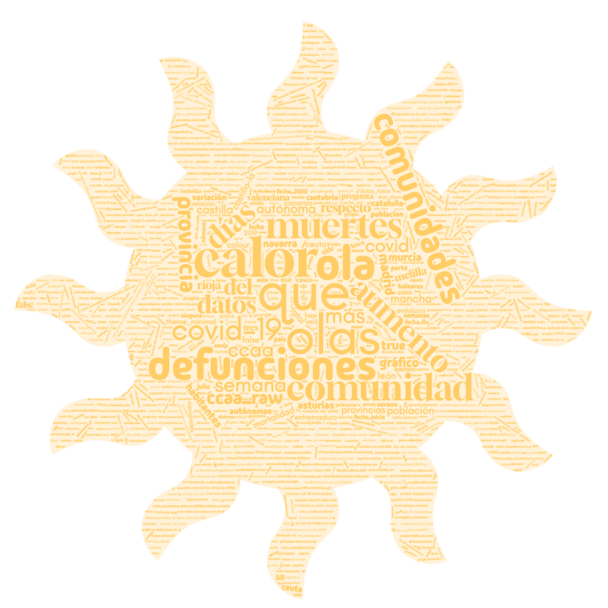

# CALOR, COVID Y MORTALIDAD EN ESPAÑA EN 2020

**Autores**: Laura Lasierra Gastón, Ángela Navarro Cantón y Sergio Pascual Redondo

**Curso Académico**: 2026/2027

**Grupo**: I

**Asignatura**: Fuentes de Datos Biomédicos y Web Semántica

---
<p align="center">
  
</p>

# 1. INTRODUCCIÓN

En este seminario se va a llevar a cabo una comprobación estadística de la relación entre las altas temperaturas, el covid y el aumento de la mortalidad en España en 2020.
En ese año, España vivió a la misma vez la primera y más grande oleada de casos de COVID-19 y un verano con varias olas de calor. Se sabe que el calor extremo lleva consigo
un aumento de la mortalidad, y que el COVID-19 provocó un incremento muy marcado de muertes con respecto a 2019, pero ambos fenómenos se solapan en el mismo año y puede ser 
complicado en algunos casos separar su efecto. No está claro si, una vez descontadas las muertes provocadas por el COVID-19, el aumento de defunciones que queda por comunidad
autónoma en 2020 con respecto a 2019 guarda relación con la exposición a olas de calor.


Vamos a estudiar esta cuestión con fuentes oficiales (AEMET e INE), utilizando R y datos en formato JSON, CSV y PC-AXIS.

# 2. OBJETIVOS

## OBJETIVO GENERAL

Analizar si el aumento de muertes en 2020 respecto a 2019 en las comunidades autónomas españolas se relaciona con las olas de calor, teniendo en cuenta las muertes por COVID-19.

## OBJETIVOS ESPECÍFICOS

1. ¿Cuántas olas de calor y cuántos días de ola se registraron en 2020 en cada provincia y CCAA?
2. ¿En qué comunidades aumentaron más las defunciones en 2020 respecto a 2019?
3. ¿Qué parte de ese aumento corresponden a muertes por COVID-19?
4. ¿Tiene relación ese aumento de muertes con las olas de calor?


## Metodología

Se realiza un estudio descriptivo y exploratorio de 2020 utilizando información agregada por provincia y comunidad autónoma. Para ello se utilizan varios conjuntos de datos procedentes principalmente de AEMET, EpData y el INE:

- Datos de olas de calor por provincia en formato JSON: provincias incluidas en cada una de las tres olas de calor nacionales registradas en 2020 (Agencia Estatal de Meteorología [AEMET], 2021).
- Datos de variación de defunciones por comunidad autónoma en formato JSON: aumento de las defunciones en 2020 respecto a 2019, procedente del INE a través de EpData (EpData, s. f.).
- Datos de defunciones atribuidas al COVID-19 por comunidad autónoma en formato CSV (Instituto Nacional de Estadística [INE], s. f.).
- Datos de población por comunidad autónoma en 2020, descargados del INE en formato PC-Axis (INE, s. f.).
- Datos de defunciones semanales de 2019 y 2020 por comunidad autónoma (INE, s. f.).
- Datos de defunciones semanales atribuidas al COVID-19 durante 2020 (INE, s. f.).

Las fuentes se importan, limpian y homogeneizan en R para utilizar nombres comunes de comunidades autónomas. Las olas de calor, originalmente registradas por provincia, se agrupan por comunidad autónoma calculando la media de días de ola por provincia. Posteriormente, las diferentes tablas se integran mediante operaciones de unión y se calcula el aumento de defunciones no atribuido oficialmente al COVID-19 por cada 100.000 habitantes.

La importación, transformación, unión y visualización de los datos se realizó con R 4.4.1 (R Core Team, 2024), siguiendo los procedimientos trabajados en la asignatura (Cánepa, 2026).

El análisis permite identificar asociaciones y patrones territoriales, pero no establecer una relación causal entre las olas de calor y las defunciones.

El análisis permite detectar asociaciones y patrones territoriales, pero no establecer una relación causal entre las olas de calor y las defunciones.

# 3. ESTRUCTURA DEL REPOSITORIO

Para mantener el orden en nuestro trabajo, hemos organizado los archivos en distintas carpetas y documentos:

- **Seminario_Fuentes.Rmd**: documento principal en R Markdown. Contiene todo el trabajo: introducción, objetivos, metodología (importación, limpieza y unión de los datos), 
gráficos y su análisis correspondiente. 


- **Seminario_Fuentes.html**: resultado al ejecutar (knit) el .Rmd. Es la versión final para leer en el navegador.


- **INPUT/DATA**: datos originales, sin modificar.
  - `olas_calor_provincias_2020.json`
  - `muertes_comunidad_autonoma_2020.json`
  - `49923.csv`: defunciones por COVID-19 por ccaa.
  - `poblacion.px`: población por ccaa
  - `muertes_semana.json`
  - `muertesCovidSemana.csv`
  - `defunciones_semana_2020_2019.json`
  
- **INPUT/IMAGENES**:
  - `fondo_seminario.png`
  - `wordcloud.png`

- **SALIDA**: gráficos exportados en formato PNG, para consultarlos sin ejecutar el código


- **Scripts**:borradores de los gráficos, que cada miembro del grupo desarrolló antes de integrarlos en el `.Rmd`.
  - `01_Analisis_Olas_Calor`: exposición al calor (días de ola por comunidad y olas por provincia).
  - `02_Mortalidad-y_Impacto_Covid`: aumento de defunciones y peso del COVID-19.
  - `03_Interaccion_Calor_Mortalidad`: relacion entre las olas de calor y las defunciones no atribuidas al COVID-19.


# 4. RESULTADOS

En 2020 hubo tres olas de calor en España. Castilla y León, Castilla-La Mancha y Andalucía aparecen en las tres. Asturias, Cantabria, Canarias, Extremadura, La Rioja, Ceuta y Melilla no aparecen en ninguna.

Murió más gente que en 2019 en todas las comunidades (entre 47 y 345 más por cada 100.000 habitantes). La mayor parte se debe al COVID-19, pero en casi todas las comunidades quedan muertes de más que el COVID-19 no explica.

Mirando el año entero, la relación entre los días de ola de calor y esas muertes de más es muy débil.

Si miramos semana a semana en verano, en Castilla-La Mancha, Madrid, Cataluña y Castilla y León las muertes extra suben justo cuando llega la ola de calor de finales de julio. Pero también hay subidas parecidas en comunidades sin olas.

**Conclusión:** Nuestros datos son compatibles con que las olas de calor contribuyeran a las muertes extra de 2020, pero no lo podemos confirmar ni descartar. Hay que tener en cuenta que los días de ola son una aproximación, que solo comparamos con 2019, que parte de las muertes "no COVID" pueden ser COVID-19 sin diagnosticar y que trabajamos con solo 19 comunidades.


# 5. INSTRUCCIONES DE EJECUCIÓN

Para reproducir este seminario se recomienda utilizar **R 4.4.1**.

## Dependencias

El proyecto ha sido desarrollado y comprobado con las siguientes versiones:

| Paquete | Versión |
|:---|:---:|
| `tidyverse` | 2.0.0 |
| `jsonlite` | 2.0.0 |
| `tidyjson` | 0.3.3.1 |
| `pxR` | 0.42.8 |
| `mapSpain` | 1.2.1 |
| `plotly` | 4.12.1 |
| `knitr` | 1.48 |
| `rmarkdown` | 2.28 |

Para ejecutar el proyecto deben seguirse estos pasos:

1. **Clonar el repositorio:**

```bash
git clone https://github.com/SergioPascualRedondo/Seminario_Fuentes_I
```

2. **Instalar las dependencias:**

```r
install.packages(c(
  "tidyverse",
  "jsonlite",
  "tidyjson",
  "pxR",
  "mapSpain",
  "plotly",
  "knitr",
  "rmarkdown"
))
```

3. **Generar el informe:** abrir `Seminario_Fuentes.Rmd` en RStudio y pulsar **Knit**. Se generará automáticamente el archivo `Seminario_Fuentes.html`.

# 6. REFERENCIAS Y RECURSOS

Agencia Estatal de Meteorología. (2021). *Informe anual 2020*.  
https://www.aemet.es/documentos/es/conocenos/a_que_nos_dedicamos/informes/InformeAnualAEMET_2020_web.pdf

Cánepa, A. (2026). *Apuntes de la asignatura Fuentes de Datos Biomédicos y Web Semántica* [Material docente no publicado].

EpData. (s. f.). *Comunidades autónomas en donde más aumentaron las muertes en 2020 respecto al año anterior*.  
https://www.epdata.es/comunidades-autonomas-donde-mas-aumentaron-muertes-2020-respecto-ano-anterior/ae983682-4d79-404e-ba6d-ee481aeeeff2

Instituto Nacional de Estadística. (s. f.). *Estimación del número de defunciones semanales*. Recuperado el 23 de noviembre de 2026, de  
https://www.ine.es/dynt3/inebase/index.htm?capsel=8465&padre=6480
# 7. LICENCIA Y REUTILIZACIÓN

El código original desarrollado para este proyecto se distribuye bajo la licencia MIT. Esta licencia no se aplica a los conjuntos de datos incluidos en `INPUT/DATA`, que conservan las condiciones de uso y reutilización establecidas por sus respectivas fuentes.

- **AEMET:** información reutilizada indicando “Fuente: AEMET”.
- **INE:** información estadística reutilizada bajo licencia CC BY 4.0, indicando su procedencia.
- **EpData:** los datos conservan las condiciones de uso establecidas por la fuente original.

Los apuntes de la asignatura se citan únicamente como material docente y no se redistribuyen en este repositorio.

R Core Team. (2024). *R: A language and environment for statistical computing* (Version 4.4.1) [Computer software]. R Foundation for Statistical Computing.  
https://www.R-project.org/


